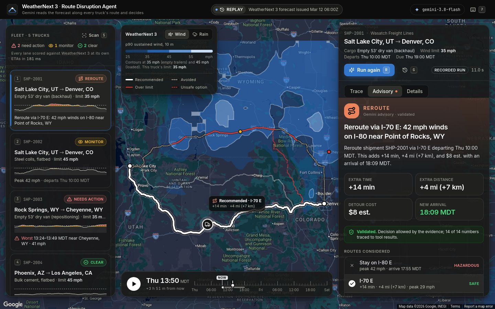
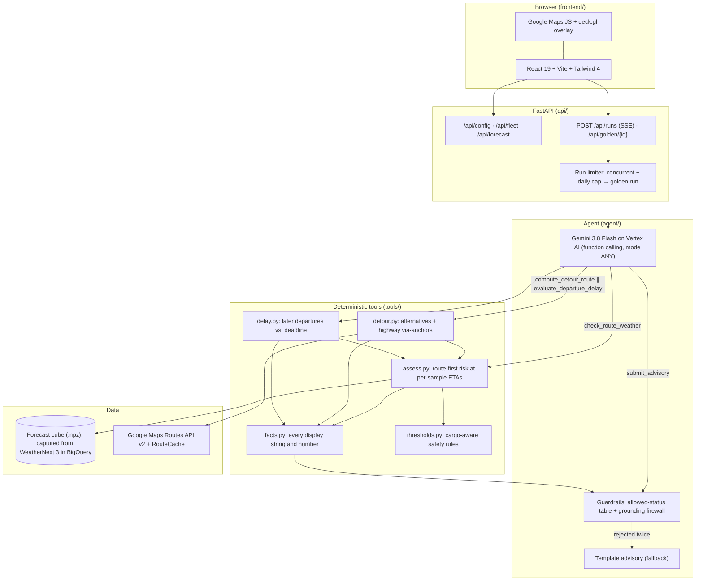
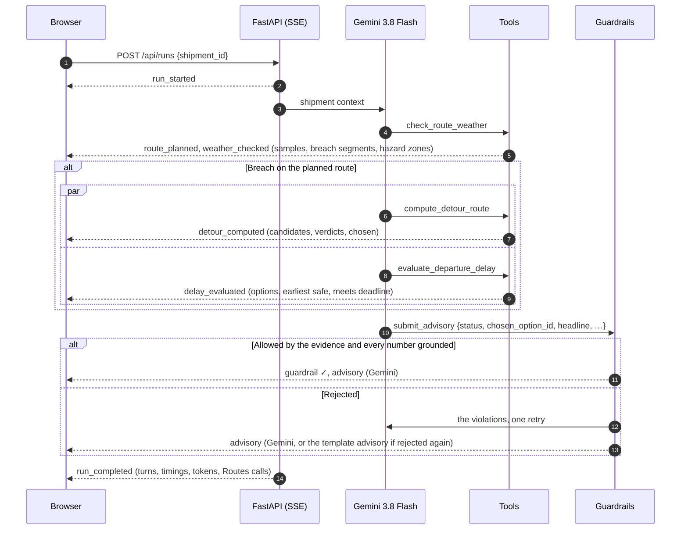

# WeatherNext Route Disruption Agent 🚛⚡🌦️

[](https://www.python.org/downloads/)
[](https://cloud.google.com/vertex-ai/generative-ai/docs/models)
[](https://cloud.google.com/bigquery)
[](https://developers.google.com/maps)
[](https://cloud.google.com/run)

A fleet dispatch agent that reads the **Google WeatherNext 3** forecast along every truck's route, at the hour the truck will actually be there, and decides what the dispatcher should do: **CLEAR**, **MONITOR**, **REROUTE** or **HOLD**. Deterministic Python finds the hazards, a detour that really avoids them (via the **Google Maps Routes API**), and the earliest safe departure. **Gemini 3.8 Flash** weighs those options and writes the advisory. Code then checks the advisory before anyone sees it: the decision must be one the evidence allows, and every number must trace back to a tool result.

**▶ Live demo: <https://weathernext-route-agent-174854610729.us-central1.run.app>**. It serves a recorded WeatherNext 3 forecast. Agent runs call Gemini live up to a daily cap; after that, recorded runs play, labelled *Recorded run*.



---

## 📑 Table of Contents

- [Key Highlights](#-key-highlights)
- [The Demo: One Storm, Five Trucks, Four Decisions](#-the-demo-one-storm-five-trucks-four-decisions)
- [System Architecture](#-system-architecture)
- [Safety Rules](#-safety-rules)
- [Getting Started](#-getting-started)
- [Presenting](#-presenting)
- [Deploying to Cloud Run](#-deploying-to-cloud-run)
- [Web API](#-web-api)
- [Model Context Protocol (MCP) Server](#-model-context-protocol-mcp-server)
- [Configuration Reference](#-configuration-reference)
- [Project Layout](#-project-layout)
- [Testing & Quality](#-testing--quality)
- [Known Limitations](#-known-limitations)

---

## 🌟 Key Highlights

- **The whole route, at the right hour.** The route is resampled every 5 km or less, and each sample gets its own ETA. The WeatherNext 3 forecast is then read at that cell over ETA ± 1 h. A storm that passes Laramie before the truck gets there is not a hazard. Anything the forecast can't see is marked *unmonitored* rather than treated as clean.
- **Detours that actually differ.** The Routes API returns no alternatives for requests with intermediate stops. So candidates come from Routes alternatives (lanes without stops) plus curated highway anchors sent as `via` waypoints. Every candidate is judged by the same `assess_route` at its own ETAs, and the fastest clean one wins.
- **Hold is a real option.** `evaluate_departure_delay` re-scores the unchanged route at later departure times against the same forecast. It makes no extra Routes calls and checks each option against the delivery deadline.
- **Code-enforced guardrails.** A status table limits which decisions each situation allows: never CLEAR on a breach, and never REROUTE onto a hazardous option. The grounding firewall requires every number-with-unit in Gemini's prose to appear in the tool results. If a check fails, Gemini gets one retry; after that, a template advisory built from the same facts is used.
- **Reasoning you can watch.** Each run streams over SSE: model turns, parallel tool calls, guardrail verdicts and the advisory. The UI draws each step as it arrives.
- **Ready for a live room.** Recorded ("golden") runs replay at real pacing and are always labelled *Recorded run*. The public URL falls back to them when the daily live-run cap is reached.
- **MCP too.** The weather check and detour tools are also exposed over the Model Context Protocol (`stdio` and `sse`).

---

## 🎬 The Demo: One Storm, Five Trucks, Four Decisions

The replay uses the real WeatherNext 3 forecast issued **2026-03-12 06:00Z**: a wind event over I-80 in southern Wyoming. The story's "now" is 10:00 MDT that morning. The fleet is defined in [`data/demo_fleet.json`](data/demo_fleet.json).

| Shipment | Lane | Cargo → wind limit | Recorded decision |
|---|---|---|---|
| **SHP-2001** ★ | Salt Lake City → Denver | Empty 53' dry van → 35 mph | **REROUTE** via I-70 E: +14 min, +4 mi (+7 km), $8 est. I-80 peaks at 42 mph near Point of Rocks, WY |
| SHP-2002 | Salt Lake City → Denver | Steel coils, flatbed → 45 mph | **MONITOR**: same storm, 42 mph is within 15% of the 45 mph limit |
| SHP-2003 | Rock Springs → Cheyenne | Empty 53' dry van → 35 mph | **HOLD** 12 h: no detour avoids the wind; departing 22:00 MDT still meets the deadline |
| SHP-2004 | Phoenix → Los Angeles | Bulk cement, flatbed → 45 mph | **CLEAR**: peak 14 mph |
| SHP-2005 | Houston → Dallas → Oklahoma City | Automotive parts, dry van → 35 mph | **CLEAR**: peak 18 mph, keeps the Dallas stop |

---

## 🏗️ System Architecture

### High-Level Data Flow



### Agent Run Lifecycle

Each tool takes only `shipment_id`. Coordinates, cargo and ETAs are resolved server-side, so the model can't invent a route or a threshold.



---

## 🛡️ Safety Rules

Every threshold is enforced in [`tools/thresholds.py`](tools/thresholds.py), never by the LLM. Wind is the WeatherNext 3 **p90 sustained 10 m wind**, not gusts.

| Hazard | Breach when | Why |
|---|---|---|
| High wind (loaded / heavy) | wind ≥ **45 mph** | NWS high-wind warning level for heavy freight |
| High wind (empty or dry van) | wind ≥ **35 mph** | High-profile, light trailers blow over at far lower speeds |
| Severe storm | precip ≥ **25 mm/hr** | Flash flooding, visibility loss, hydroplaning |
| Black ice | temp ≤ **32 °F** and precip ≥ **0.1 mm/hr** | Freezing moisture on the road; 0.1 mm/hr is the measurable-precip floor, so p90 trace values don't flag every cold night |
| *Near limit* (MONITOR) | within **15%** of a limit | Worth watching, not acting on |

The decision each situation allows (see [`agent/advisory.py`](agent/advisory.py)):

| Situation | Allowed decision |
|---|---|
| Every sample below its limits | CLEAR |
| Near a limit, or part of the route unmonitored | MONITOR |
| Breach, with a safe detour and/or a safe later departure | REROUTE onto that detour and/or HOLD until that time. If any safe option meets the deadline, options that miss it are dropped |
| Breach, nothing safe inside the forecast | HOLD, open-ended (re-check at the next forecast) |

---

## 🚀 Getting Started

### Prerequisites

- Python 3.11+ and [uv](https://docs.astral.sh/uv/)
- Node.js 22
- `gcloud`, signed in with `gcloud auth application-default login` for Gemini on Vertex AI
- A GCP project with the Vertex AI API enabled

```bash
git clone https://github.com/cloud-ai-fde/gauravks-weathernext-route-disruption-agent.git
cd gauravks-weathernext-route-disruption-agent

uv sync --extra dev                  # Python deps + pytest/ruff
(cd frontend && npm ci)              # frontend deps
cp .env.example .env                 # then set GCP_PROJECT_ID and MAPS_JS_API_KEY
```

### Forecast, routes and recorded runs

Three data directories feed the app. They are **not in git** (WeatherNext and Google Maps data terms), so create them once:

| Directory | What it holds | How to create it |
|---|---|---|
| `data/replay/` | One WeatherNext 3 forecast init as a numpy cube | `uv run python -m scripts.capture_replay --init 2026-03-12T06:00:00Z --dry-run`, then again with `--out data/replay/wn3_20260312T06Z.npz`. Needs your own WeatherNext 3 BigQuery subscription (see [below](#live-weathernext-3-access)). The dry run prints the bytes billed first. |
| `data/routes_cache/` | Recorded Routes API responses | `uv run python -m scripts.dry_run --all` with `GOOGLE_MAPS_ROUTES_API_KEY` set. Re-record at least every 30 days. |
| `data/golden/` | Recorded agent runs (JSONL event streams) | `uv run python -m scripts.record_run SHP-2001 --out data/golden/SHP-2001.jsonl` (one per shipment; runs real Gemini) |

Without a replay cube the API starts, but it has no forecast to serve.

### Run it locally

```bash
# Terminal 1: API on :8000
uv run uvicorn api.main:app --port 8000

# Terminal 2: frontend dev server on :3000, with /api proxied to :8000
cd frontend && npm run dev
```

Open <http://localhost:3000>. For production-like serving, run `cd frontend && npm run build`; FastAPI then serves `frontend/dist` itself at <http://localhost:8000>, with no second process and no restart.

Check the pipeline without an LLM, and without any Routes calls once the cache is recorded:

```bash
uv run python -m scripts.dry_run --shipment SHP-2001 --cache replay
```

### Live WeatherNext 3 access

WeatherNext 3 access is allowlist-gated. To subscribe your own project:

```bash
bash scripts/00_enable_routes_api.sh               # Routes API
cat  scripts/01_discover_weathernext_listing.md    # request WeatherNext 3 access
bash scripts/02_subscribe_analytics_hub_listing.sh # subscribe the listing into BigQuery
bash scripts/03_create_maps_routes_api_key.sh      # server-side Routes key
bash scripts/04_verify_setup.sh                    # end-to-end check
```

---

## 🎤 Presenting

**URL presets**

| Preset | Effect |
|---|---|
| `?shipment=SHP-2001` | select a truck |
| `&golden=1` | play its recorded run at real pacing (`golden=4` plays at 4×) |
| `&run=1` | start a live Gemini run once loaded |
| `&stage=1` | projector sizing: larger type, thicker lines, wider panel |
| `&tab=trace` / `advisory` / `details` | open a panel tab |
| `&t=2.5` | open the time scrubber 2.5 h after "now" |
| `&attract=0` | disable the idle auto-demo, which plays the recorded runs after 60 s untouched (already off with `stage=1`) |
| `&nostream=1` | use the non-streaming path (proxy-buffering drill) |

**Hotkeys** (press `?` in the app for the overlay)

| Key | Action |
|---|---|
| `1`–`5` | select a truck |
| `R` | run the agent live |
| `G` | play the recorded run |
| `S` | rescan the fleet |
| `Space` | play/pause the forecast |
| `←` / `→` | step the forecast by one hour |
| `0` | frame the whole fleet |
| `A` | start the auto-demo |

---

## ☁️ Deploying to Cloud Run

One public Cloud Run service serves both the API and the built frontend. The root [`Dockerfile`](Dockerfile) builds the React app with Node, then runs FastAPI on a locked `uv` environment.

```bash
./scripts/deploy.sh                  # first deploy and every redeploy
SKIP_SETUP=1 ./scripts/deploy.sh     # rebuild and redeploy only
```

The script is idempotent:

- **One-time setup.** It enables the APIs, creates a runtime and a build service account with only the roles they need, and stores the Routes key in **Secret Manager**. The key never becomes an env var, is never baked into the image, and never appears in `/api/config`. It also sets a $50 budget alert.
- **Deploy.** It deploys with `--no-invoker-iam-check` (public without `allUsers`), 1 to 3 instances, and CPU boost.
- **Browser key.** It restricts the browser Maps key to the service URL plus localhost, and to the Maps JavaScript API only.
- **Verify.** It finishes with [`scripts/smoke.sh`](scripts/smoke.sh), which also runs on its own:

```bash
./scripts/smoke.sh                                  # against http://localhost:8000
./scripts/smoke.sh https://<service>.run.app --live # plus one real Gemini run
```

The smoke test checks:
- health
- that `/api/config` carries no Routes key
- SPA routing
- the fleet scan
- forecast ETag/304 caching
- that SSE frames arrive as a stream
- with `--live`: that a real run completes with a Gemini-written advisory

[`.gcloudignore`](.gcloudignore) keeps `.env` out of the upload but ships the three data directories into the (private) image.

After the event, stop paying for the always-on instance:

```bash
gcloud run services update weathernext-route-agent --min-instances 0 --region us-central1 --project "$GCP_PROJECT_ID"
```

---

## 🔌 Web API

| Endpoint | Purpose |
|---|---|
| `GET /api/health` | status, git SHA, forecast modes, recorded runs |
| `GET /api/config` | what the browser needs: Maps JS key, Map ID, model, modes, live runs left today |
| `GET /api/fleet` | deterministic fleet scan (no LLM): status, peak, first breach, risk-strip series |
| `GET /api/forecast?var=wind_mph\|precip_mm_hr` | every forecast hour as a quantized uint8 grid, with an ETag |
| `POST /api/runs` `{"shipment_id": "SHP-2001"}` | live agent run as SSE (`?stream=0` returns the same events as one JSON array) |
| `GET /api/golden/{id}?speed=1` | recorded run as SSE at real pacing |

Every SSE frame is `data: {"v":1, "run_id", "seq", "t_ms", "type", …}`. The event types are `run_started`, `route_planned`, `model_turn`, `tool_call`, `tool_result`, `weather_checked`, `detour_computed`, `delay_evaluated`, `guardrail`, `advisory`, `run_completed` and `error`. The pydantic models live in [`agent/events.py`](agent/events.py); [`frontend/src/types.ts`](frontend/src/types.ts) mirrors them.

---

## 🔌 Model Context Protocol (MCP) Server

[`mcp_server.py`](mcp_server.py) exposes the weather check and the detour to external AI clients (Claude Desktop, IDEs, other agents). Here the caller supplies the waypoints, and the weather check queries **live WeatherNext 3 in BigQuery**. It uses the same `tools/thresholds.py` rules as the web agent.

```bash
uv run python -m mcp_server --transport stdio            # Claude Desktop / IDE extensions
uv run python -m mcp_server --transport sse --port 8932  # HTTP clients
```

- **`check_route_weather`**: `shipment_id`, `waypoints` (lat, lon, ETA) and an optional `cargo_description`. Returns per-waypoint observations, breaches and hazard polygons.
- **`compute_detour_route`**: `origin`, `destination`, optional `intermediates` and `hazard_polygons`. Returns the detour geometry and time/distance deltas.

---

## ⚙️ Configuration Reference

Set these in the environment or in `.env`. The full list with explanations is in [`config.py`](config.py).

| Variable | Default | Description |
|---|---|---|
| `GCP_PROJECT_ID` | *required* | Project for Vertex AI (and BigQuery for MCP / capture) |
| `GEMINI_MODEL` | `gemini-3.8-flash` | Model behind the agent |
| `GEMINI_FALLBACK_MODEL` | `gemini-2.5-flash` | Used if Vertex AI doesn't serve `GEMINI_MODEL` (404) |
| `GEMINI_THINKING_LEVEL` | `low` | Gemini 3 thinking level |
| `VERTEX_LOCATION` | `global` | Vertex AI endpoint |
| `GOOGLE_GENAI_USE_VERTEXAI` | `1` | Vertex AI (`1`) or the Gemini API (`0`) |
| `MAPS_JS_API_KEY` | empty | Browser key for the Maps JavaScript API. Restrict it by referrer and API. Without it the map falls back to a plain graticule |
| `MAP_ID` | empty | Your styled vector Map ID. Empty uses Google's `DEMO_MAP_ID` in the dark colour scheme |
| `GOOGLE_MAPS_ROUTES_API_KEY` | empty | Server-side Routes key. Without it, only recorded routes are used |
| `ROUTES_CACHE_MODE` | `live` if a Routes key is set, else `replay` | `replay` never calls the Routes API |
| `REPLAY_CUBE_PATH` / `ROUTES_CACHE_DIR` / `GOLDEN_DIR` | under `data/` | Where the three data directories live |
| `MAX_CONCURRENT_RUNS` | `4` | Live Gemini runs at once, per instance |
| `DAILY_LIVE_RUN_CAP` | `300` | Live runs per day per instance before recorded runs are served |
| `DETOUR_COST_PER_MILE_USD` | `2.00` | Blended cost per mile for the detour cost estimate |
| `BQ_LOCATION`, `WEATHERNEXT_DATASET`, `WEATHERNEXT_TABLE` | `US`, `weathernext_3`, `weathernext_3_0_0_0p1deg` | Your WeatherNext 3 subscription |
| `WEATHERNEXT_MAX_BYTES_BILLED` | 2 TiB | Hard per-query BigQuery cap (MCP weather check) |

---

## 📂 Project Layout

```text
├── agent/
│   ├── runner.py          # Gemini tool loop: 4 tools, parallel calls, retry, fallback, cancel
│   ├── advisory.py        # allowed-status table, grounding firewall, template advisory
│   ├── prompt.py          # system instruction + tool declarations
│   ├── events.py          # SSE event contract (pydantic)
│   └── views.py           # tool results → compact views for Gemini and the UI
├── api/
│   ├── main.py            # FastAPI routes + static SPA
│   ├── streaming.py       # SSE framing, keepalive, golden replay pacing
│   ├── fleet.py           # deterministic fleet scan
│   └── state.py           # forecast scenes, route cache, golden runs, run limiter
├── tools/
│   ├── assess.py          # assess_route: the one safety judgement for every option
│   ├── cube.py, geo.py    # forecast cube sampling, route resampling + ETAs
│   ├── detour.py          # detour candidates and choice
│   ├── delay.py           # departure-delay options
│   ├── facts.py           # every number and string shown to Gemini or the UI
│   ├── routing.py         # Routes API v2 client + RouteCache
│   ├── thresholds.py      # cargo-aware safety rules
│   └── weather.py         # live BigQuery waypoint check (MCP)
├── frontend/              # React app (map, fleet rail, agent panel, time scrubber)
│   └── scripts/           # shots.mjs (screenshot matrix), contrast.mjs (WCAG check)
├── data/                  # demo_fleet.json, anchors.json, places.json (+ untracked replay/, routes_cache/, golden/)
├── scripts/               # deploy.sh, smoke.sh, capture_replay.py, dry_run.py, record_run.py, run_evals.py, GCP onboarding
├── tests/                 # pytest: pipeline, agent (fake Gemini), API, MCP
├── evals/                 # cases.jsonl for scripts/run_evals.py (live Gemini)
├── mcp_server.py          # MCP adapter (stdio / SSE)
├── config.py, schemas.py
└── Dockerfile
```

---

## 🧪 Testing & Quality

No test needs live credentials. Gemini, BigQuery and the Routes API are replaced by fakes and small synthetic forecast cubes.

```bash
uv run pytest --cov              # coverage gate: 80%
uv run ruff check .

cd frontend
npm test                         # vitest: SSE parser, run reducer, map layers, app smoke
npm run typecheck && npm run build
npm run contrast                 # WCAG contrast of every text/surface token pair
npm run shots -- --base=http://localhost:8000   # screenshot matrix → frontend/screenshots/
```

**Live evals** run the real agent (Gemini on Vertex AI, recorded routes) over the cases in [`evals/cases.jsonl`](evals/cases.jsonl), several times each:

```bash
uv run python -m scripts.run_evals             # 3 runs per case → evals/artifacts/<timestamp>.json
```

Every check has a ground truth, so there is no LLM judge:
- **Decision:** the status and option match the expected ones.
- **Safety:** the chosen option is re-checked against the run's own detour and delay evidence.
- **Fallbacks:** how many runs ended in the template advisory.
- **Latency.**

The pass bar is 100% safe, at least 90% expected decisions, at most 10% template fallbacks, and p95 under 30 s.

`shots.mjs` drives headless Chromium through every state: hero, hold, monitor, clear, stage and phone viewports, and grayscale and deuteranopia filters. It reports console errors. Headless Chrome renders with SwiftShader, so it gets Google's raster map; real GPUs get vector.

---

## 🔍 Known Limitations

- **Car-profile routing.** The Routes API has no truck profile, so height, weight and hazmat restrictions are not modelled.
- **Sustained wind, not gusts.** The limits apply to WeatherNext 3's p90 sustained 10 m wind.
- **Recorded forecast in the web app.** The web app serves one captured forecast init (`scripts/capture_replay.py`). The live BigQuery path is the MCP `check_route_weather` tool.
- **No hail.** WeatherNext 3 forecasts wind, precipitation and temperature, but not hail.

---

## 📄 License

Apache License 2.0. See [LICENSE](LICENSE).
