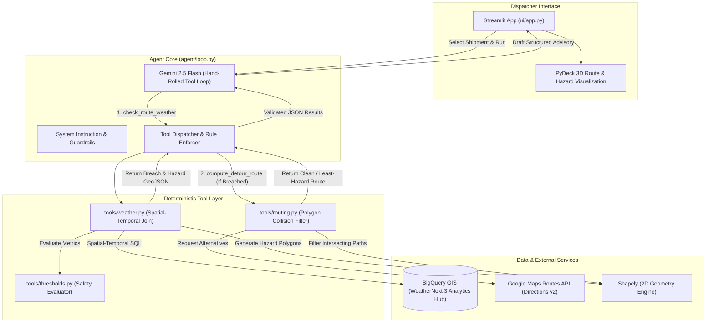
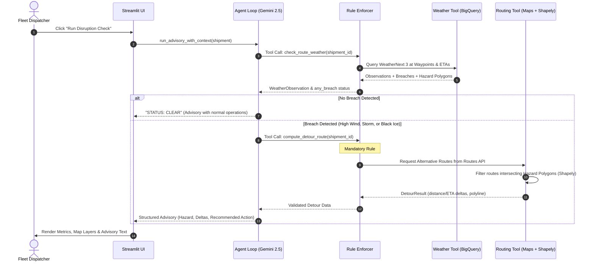

# WeatherNext Route Disruption Agent 🚛⚡🌦️

[](https://www.python.org/downloads/)
[](https://deepmind.google/technologies/gemini/)
[](https://cloud.google.com/bigquery)
[](https://developers.google.com/maps/documentation/routes)
[](https://modelcontextprotocol.io/)
[](tests/)

An autonomous, weather-aware fleet dispatch copilot that fuses **Google WeatherNext 3** gridded atmospheric forecasts with commercial freight routes. When extreme weather threatens an active shipment, the agent deterministically detects safety breaches, computes hazard-avoiding detours using the **Google Maps Routes API**, and uses **Gemini 2.5 Flash** to draft actionable dispatcher advisories.

> [!TIP]
> **Zero GCP Setup Required to Test:** The application includes a **Simulation Mode** (enabled by default). You can test live Gemini reasoning, deterministic safety checks, and real Google Maps rerouting with zero BigQuery cost or Analytics Hub onboarding.

---

## 📑 Table of Contents

- [Key Highlights](#-key-highlights)
- [System Architecture](#-system-architecture)
  - [High-Level Data Flow](#high-level-data-flow)
  - [Agent Execution Lifecycle](#agent-execution-lifecycle)
- [Safety Thresholds & Cargo Dynamics](#-safety-thresholds--cargo-dynamics)
- [Getting Started](#-getting-started)
  - [Prerequisites](#prerequisites)
  - [1. Quickstart (Simulation Mode)](#1-quickstart-simulation-mode)
  - [2. Live WeatherNext 3 Setup (Production Mode)](#2-live-weathernext-3-setup-production-mode)
- [Dispatcher UI](#-dispatcher-ui)
- [Model Context Protocol (MCP) Server](#-model-context-protocol-mcp-server)
- [Configuration Reference](#-configuration-reference)
- [Project Directory Layout](#-project-directory-layout)
- [Testing & Quality Assurance](#-testing--quality-assurance)
- [Known Scope Limitations & Roadmap](#-known-scope-limitations--roadmap)

---

## 🌟 Key Highlights

- **Zero-Hallucination Architecture:** Gemini Flash never guesses weather metrics or creates arbitrary geometry. Hazard polygons and threshold breaches are calculated deterministically in Python via BigQuery GIS and Shapely before Gemini ever sees them.
- **Enforced Guardrails (Mandatory Rules):** The hand-rolled function-calling loop programmatically blocks invalid actions (e.g., Gemini cannot request a detour for a clear route, nor can it request a detour before checking weather).
- **Cargo-Aware Wind Rollover Modeling:** Automatically adjusts wind tolerances based on trailer dynamics (alerting at 35 mph for empty/dry-van trailers vs. 45 mph for heavy freight).
- **Spatial Collision Rerouting:** Because Google Maps Routes API lacks a native "avoid polygon" parameter, the routing tool requests alternative routes and applies 2D Shapely intersection filters against WeatherNext hazard geometries to surface the safest detour.
- **Dual Consumption Interfaces:** Includes a Streamlit dispatcher dashboard with 3D PyDeck maps and a standardized **MCP Server** (`stdio` and `sse`) for external AI copilot orchestration.

---

## 🏗️ System Architecture

### High-Level Data Flow



### Agent Execution Lifecycle



---

## 🛡️ Safety Thresholds & Cargo Dynamics

All thresholds are calculated in [`tools/thresholds.py`](tools/thresholds.py) and never by the LLM:

| Hazard Type | Threshold Condition | Operational Rationale |
|---|---|---|
| **High-Wind (Standard)** | Wind Speed $\ge$ **45.0 mph** | National Weather Service high-wind warning threshold for heavy freight. |
| **High-Wind (Dry-Van / Empty)** | Wind Speed $\ge$ **35.0 mph** | Empty and light dry-van trailers have a significantly higher risk of rollover in crosswinds. |
| **Severe Storm** | Precipitation $\ge$ **25.0 mm/hr** | Intense rainfall causing flash floods, severe visibility loss, and hydroplaning risk. |
| **Black Ice** | Temp $\le$ **32.0°F (0°C)** AND Precip > **0.0 mm/hr** | Any freezing moisture on road surfaces creates hazardous, invisible ice layers. |

---

## 🚀 Getting Started

### Prerequisites

- **Linux / macOS**
- **Python 3.11+**
- **uv** (recommended) or `pip`

```bash
# Clone the repository
git clone https://github.com/your-org/weathernext-route-disruption-agent.git
cd weathernext-route-disruption-agent

# Create virtual environment and install dependencies
uv venv --python 3.11 .venv
source .venv/bin/activate
uv pip install -e ".[dev]"

# Configure environment
cp .env.example .env
```

---

### 1. Quickstart (Simulation Mode)

Simulation mode runs real Gemini reasoning and real Google Maps routing against realistic, pre-configured weather scenarios without requiring access to Google's WeatherNext Analytics Hub listing:

```bash
streamlit run ui/app.py
```

1. Open `http://localhost:8501` in your browser.
2. Select an active shipment from the sidebar (e.g., `SHP-001`).
3. Keep the data source set to **"Simulation Mode (Offline Demo)"**.
4. Select a scenario:
   - *Severe Storm & High Wind (Breach)*
   - *Black Ice Risk (Breach)*
   - *Clear Weather (Safe, No Breach)*
5. Click **"Run Disruption Check"**.

---

### 2. Live WeatherNext 3 Setup (Production Mode)

To connect the agent to live Google WeatherNext 3 atmospheric data and live Google Maps routing, configure your GCP project:

```bash
# 1. Enable Routes API in your GCP project
bash scripts/00_enable_routes_api.sh

# 2. Follow instructions to request WeatherNext 3 Analytics Hub access
cat scripts/01_discover_weathernext_listing.md

# 3. Subscribe the Analytics Hub listing into BigQuery
bash scripts/02_subscribe_analytics_hub_listing.sh

# 4. Generate a restricted Google Maps API key
bash scripts/03_create_maps_routes_api_key.sh

# 5. Run the end-to-end verification smoke test
bash scripts/04_verify_setup.sh
```

Ensure the following variables are filled in your `.env`:

```env
GCP_PROJECT_ID="your-gcp-project-id"
GOOGLE_MAPS_ROUTES_API_KEY="your-restricted-maps-key"
WEATHERNEXT_DATASET="weathernext_3"
```

---

## 🖥️ Dispatcher UI

The Streamlit dashboard ([`ui/app.py`](ui/app.py)) provides a unified single-pane operational view:

1. **Safety Status & KPI Bar:** Displays breach status, detour distance delta ($\pm\text{km}$), transit time delta ($\pm\text{min}$), and estimated reroute cost.
2. **Interactive 3D PyDeck Map:**
   - 🔵 **Primary Route:** Active planned shipment transit line.
   - 🟢 **Detour Route:** Clean route bypassing all hazard polygons.
   - 🔴 **Hazard Polygons:** Exact buffered geographical boundaries of severe weather cells.
   - 📍 **Waypoints:** Origin, intermediate stops, and destination markers with ETA tooltips.
3. **Structured Advisory Panel:** Actionable dispatch instructions categorized into *Hazard Identified*, *Route Comparison*, and *Recommended Action*.

---

## 🔌 Model Context Protocol (MCP) Server

The repository includes a production-grade MCP server ([`mcp_server.py`](mcp_server.py)) implementing the Model Context Protocol v2. External AI systems (Claude Desktop, Cursor, external multi-agent systems) can call the exact same underlying tools:

### Running the Server

```bash
# Standard I/O mode (for Claude Desktop / IDE extensions)
python -m mcp_server --transport stdio

# SSE mode (for HTTP / web agent networks)
python -m mcp_server --transport sse --port 8932
```

### Exposed MCP Tools

- **`check_route_weather`**: Accepts `shipment_id`, list of `waypoints` (lat, lon, ETA), and optional `cargo_description`. Returns deterministic observations and hazard polygons.
- **`compute_detour_route`**: Accepts `origin`, `destination`, optional `intermediates`, and `hazard_polygons`. Returns clean detour geometry and time/distance deltas.

---

## ⚙️ Configuration Reference

All settings can be overridden via environment variables or `.env`:

| Variable | Default | Description |
|---|---|---|
| `GCP_PROJECT_ID` | *Required* | GCP project hosting Vertex AI and BigQuery. |
| `BQ_LOCATION` | `US` | Location of the BigQuery WeatherNext 3 dataset. |
| `WEATHERNEXT_DATASET` | `weathernext_3` | Subscribed Analytics Hub dataset identifier. |
| `WEATHERNEXT_TABLE` | `weathernext_3_0_0_0p1deg` | WeatherNext 3 0.1° (~10km) forecast view. |
| `WEATHERNEXT_WIND_VARIABLE` | `wind_speed_10m` | Field name for surface wind speed. |
| `WEATHERNEXT_INIT_LOOKBACK_HOURS` | `24` | Lookback window for forecast initialization (optimizes BigQuery scan cost). |
| `WEATHERNEXT_MAX_BYTES_BILLED` | `2 TB` | Hard BigQuery spending safety cap per query. |
| `WEATHERNEXT_CACHE_TTL_SECONDS` | `3600` | In-memory cache TTL for weather check responses. |
| `GOOGLE_MAPS_ROUTES_API_KEY` | *Required (Live)* | API key with access to `routes.googleapis.com`. |
| `DETOUR_COST_PER_MILE_USD` | `2.00` | Blended cost per mile used to calculate detour operational impact. |
| `GEMINI_MODEL` | `gemini-2.5-flash` | Gemini model variant powering the copilot. |
| `VERTEX_LOCATION` | `global` | Vertex AI regional endpoint. |
| `GOOGLE_GENAI_USE_VERTEXAI` | `1` | Use Vertex AI enterprise credentials (`1`) or AI Studio (`0`). |

---

## 📂 Project Directory Layout

```text
weathernext-route-disruption-agent/
├── agent/                      # Core agent reasoning & guardrail loop
│   ├── loop.py                 # Hand-rolled function-calling loop with hard guardrails
│   ├── system_instruction.py   # Grounded prompt contracts & advisory formats
│   └── tool_schemas.py         # Gemini FunctionDeclaration schemas
├── data/                       # Fixture data & shipment loaders
│   ├── __init__.py             # Dynamic ETA resolver
│   └── mock_shipments.json     # Sample commercial freight shipments
├── scripts/                    # Automated GCP onboarding & verification
│   ├── 00_enable_routes_api.sh
│   ├── 01_discover_weathernext_listing.md
│   ├── 02_subscribe_analytics_hub_listing.sh
│   ├── 03_create_maps_routes_api_key.sh
│   └── 04_verify_setup.sh
├── tests/                      # Unit, integration & cassette tests
│   ├── cassettes/              # Sanitized replay cassettes for deterministic testing
│   ├── test_agent_loop.py
│   ├── test_routing_tool.py
│   ├── test_thresholds.py
│   └── test_weather_tool.py
├── tools/                      # Deterministic computation engines
│   ├── polyline_codec.py       # Google Encoded Polyline to Shapely LineString converter
│   ├── routing.py              # Google Maps Routes API v2 + polygon filtering
│   ├── thresholds.py           # Cargo-aware deterministic safety rules
│   └── weather.py              # BigQuery GIS spatial-temporal WeatherNext join
├── ui/                         # Dispatcher frontend
│   ├── app.py                  # Streamlit dashboard
│   └── map_layers.py           # PyDeck 3D map layer compositions
├── config.py                   # Central configuration & environment loader
├── mcp_server.py               # MCP protocol adapter (stdio / SSE)
├── pyproject.toml              # Project dependencies & tool configurations
└── schemas.py                  # Shared Pydantic domain models
```

---

## 🧪 Testing & Quality Assurance

The codebase includes an extensive automated test suite with full mocking and replayable cassettes:

```bash
# Run pytest with code coverage
pytest --cov --cov-report=term-missing
```

- **69 tests passing across all components (~81% code coverage).**
- **Zero live credentials required for testing:** BigQuery GIS and Routes API interactions are fully mocked.
- **Cassette Determinism:** The Gemini agent reasoning loop tests replay from sanitized, recorded cassettes in [`tests/cassettes/`](tests/cassettes/).

---

## 🔍 Known Scope Limitations & Roadmap

- **Surface Road Freight Only:** Safety models are calibrated for commercial trucking (dry-van rollovers and asphalt black ice). Aviation and maritime verticals require 3D flight-level weather or marine sea-state models.
- **Waypoint Weather Sampling:** Weather is queried at designated route waypoints (origin, intermediate stops, destination). Mid-corridor storms occurring entirely between distant waypoints are not sampled; continuous route polyline densification is planned on the roadmap.
- **No Hail in WeatherNext 3:** Google WeatherNext 3 models wind, precipitation, and temperature, but does not provide a direct hail parameter.

---

## 📄 License

This project is licensed under the Apache License 2.0. See [LICENSE](LICENSE) for details.
